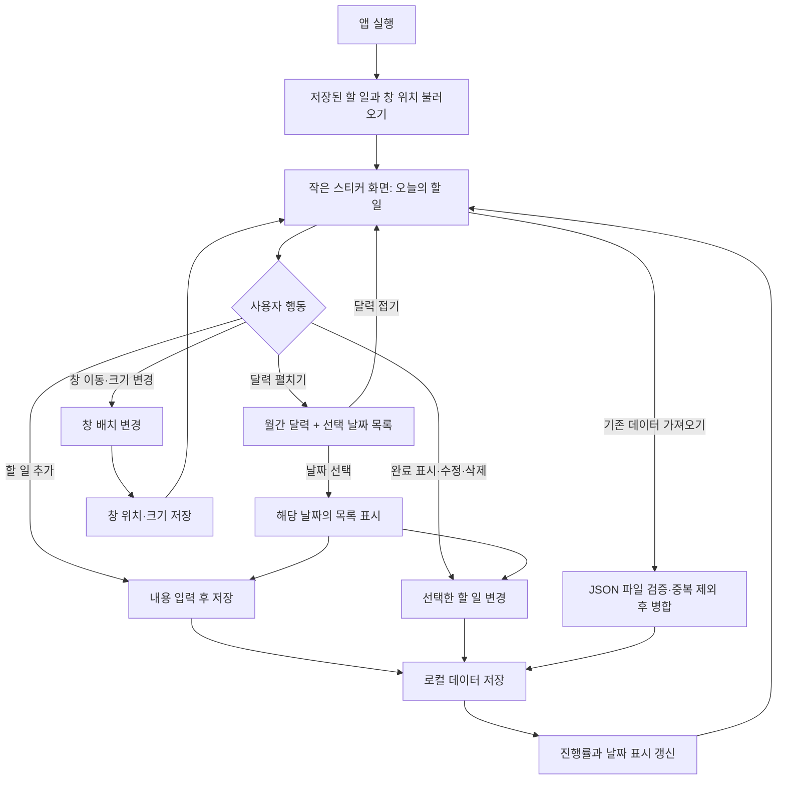

# Daymark 위젯 사용 흐름

## 핵심 화면

1. **기본 화면:** 오늘 날짜, 진행률, 입력창, 할 일 목록. 할 일이 많으면 목록만 스크롤.
2. **달력 화면:** 왼쪽 월간 달력과 오른쪽 선택 날짜의 목록. 날짜 선택 시 오른쪽 내용 갱신.
3. **더보기 메뉴:** 기존 JSON 가져오기·내보내기, 항상 위에 표시, 시작 시 실행 등 설정.

## 구현 경계

- 이 문서는 UX 설계안입니다. `mockup.html`은 화면 비교용이며 데이터를 저장하지 않습니다.
- Rust 측에서 할 일 저장, 파일 가져오기·내보내기, 창 위치 저장을 구현합니다.
- 화면은 기존 HTML/CSS를 재사용할 수 있지만, 스티커 크기에 맞춰 별도 레이아웃을 적용합니다.
